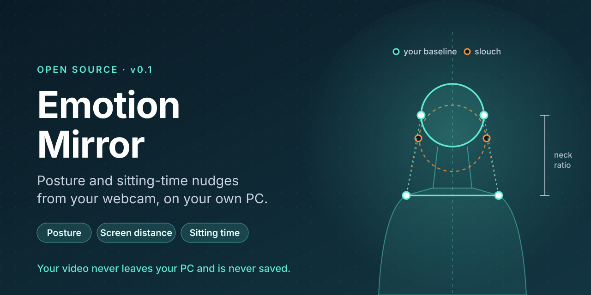

<p align="center">
  
</p>

# Emotion Mirror

[English](README.md)

Copiloto de bienestar local para personas que trabajan frente al ordenador. Usa tu cámara web y la IA local de [NeuroBrix](https://neurobrix.ai) para detectar mala postura, largos periodos sentado, fatiga y tensión, y te da avisos amables y personalizados.

**Tu vídeo nunca sale de tu PC y nunca se guarda.**

> **Estado: v0.1 (temprana).** La postura, la distancia a la pantalla, el tiempo sentado y la calibración funcionan y se han comprobado a mano en Windows 11 con Python 3.11. Todavía sin confirmar en hardware real: las notificaciones de escritorio, macOS y Linux. NeuroBrix aún no está integrado (previsto para la v0.3): la v0.1 redacta los avisos con plantillas de mensajes del archivo de reglas. Espera tener que ajustar los umbrales a tu cuerpo y a tu mesa.

## Qué hace la v0.1

- **Postura:** detecta cuando la cabeza se hunde hacia delante, hacia los hombros.
- **Inclinación de hombros:** detecta cuando un hombro está mucho más alto que el otro.
- **Distancia a la pantalla:** detecta cuando te acercas demasiado.
- **Tiempo sentado:** te recuerda que te levantes después de mucho rato sin moverte.
- **Calibración:** todo se mide contra *tu* referencia de "sentado bien", que se graba en 10 segundos.
- **Tus reglas:** umbrales, duraciones, esperas y mensajes están en un archivo YAML que puedes editar.

## Instalación paso a paso

Necesitas Python y una cámara web. Todo lo siguiente se escribe en una terminal. Primero van los pasos para Windows; macOS y Linux cambian solo donde se indica.

### 1. Instala Python

Emotion Mirror necesita **Python 3.10 o superior**. Se recomienda Python 3.11 o 3.12 (con la 3.11 se ha probado).

Primero comprueba si ya lo tienes. Abre una terminal:

- **Windows:** pulsa la tecla Windows, escribe `cmd` y pulsa Enter.
- **macOS:** abre la app *Terminal*.
- **Linux:** abre tu terminal.

Luego ejecuta:

```
python --version
```

(en macOS y Linux: `python3 --version`). Si muestra `Python 3.10` o superior, salta al paso 2.

Si muestra una versión anterior, un error, o se abre la Microsoft Store, instala Python:

**Windows**

1. Entra en <https://www.python.org/downloads/> y descarga el instalador de Python 3.12 para Windows.
2. Ejecútalo. En la primera pantalla, **marca "Add python.exe to PATH"** (abajo del todo) y pulsa **Install Now**.
3. Cierra la terminal, abre una nueva y vuelve a ejecutar `python --version`. Debe mostrar la versión nueva.

El Python de la Microsoft Store también funciona, pero mira la nota de la cámara en el paso 6.

**macOS**

Descarga el instalador para macOS en <https://www.python.org/downloads/> y ejecútalo, o, si usas Homebrew: `brew install python@3.12`. Comprueba con `python3 --version`.

**Linux (Debian / Ubuntu)**

```
sudo apt update
sudo apt install python3 python3-venv python3-pip
```

### 2. Descarga el proyecto

**Sin Git (lo más simple):** descarga <https://github.com/vladt2024/emotion-mirror/archive/refs/heads/main.zip> y descomprímelo. En Windows, clic derecho sobre el ZIP → *Extraer todo*. Obtendrás una carpeta llamada `emotion-mirror-main`.

**Con Git:**

```
git clone https://github.com/vladt2024/emotion-mirror.git
```

### 3. Abre una terminal dentro de la carpeta del proyecto

La carpeta debe contener un archivo llamado `pyproject.toml`.

**Windows (cmd), si lo descomprimiste en Descargas:**

```
cd %USERPROFILE%\Downloads\emotion-mirror-main
dir pyproject.toml
```

Si `dir` dice que no encuentra el archivo, la extracción creó una carpeta dentro de otra. Baja un nivel y comprueba otra vez:

```
cd emotion-mirror-main
dir pyproject.toml
```

**macOS / Linux:**

```
cd ~/Downloads/emotion-mirror-main
ls pyproject.toml
```

### 4. Crea un entorno virtual e instala

Un entorno virtual mantiene las librerías del proyecto separadas del resto de tu sistema. Se hace una sola vez.

**Windows (cmd):**

```
python -m venv .venv
.venv\Scripts\activate
pip install -e .
```

**macOS / Linux:**

```
python3 -m venv .venv
source .venv/bin/activate
pip install -e .
```

Tras activarlo, la línea de la terminal empieza por `(.venv)`. La instalación descarga MediaPipe, OpenCV y otras librerías y tarda unos minutos. Comprueba que ha funcionado:

```
emotion-mirror --version
```

En Windows usa el Símbolo del sistema (`cmd`). En PowerShell, la política de ejecución puede bloquear la activación.

### 5. Descarga los modelos

```
emotion-mirror download-models
```

Descarga dos archivos de modelo pequeños de MediaPipe (cara y pose) en `~/.emotion-mirror/models` (en Windows, `C:\Users\<tú>\.emotion-mirror\models`). Se hace una sola vez. Es la única vez que el propio programa usa la red.

### 6. Permite el acceso a la cámara

**Windows 10/11:** abre *Configuración → Privacidad y seguridad → Cámara* y comprueba que estén activados:

- **Acceso a la cámara.**
- **Permitir que las aplicaciones accedan a la cámara** (*Let apps access your camera*).
- **Permitir que las aplicaciones de escritorio accedan a la cámara** (*Let desktop apps access your camera*).
- Si instalaste Python desde la **Microsoft Store**, aparece en la lista de aplicaciones como **Python 3.x**. Activa también ese interruptor, porque la versión de la Store tiene su propio permiso.

Cierra cualquier aplicación que esté usando la cámara (Teams, Zoom, WhatsApp, Telegram, una pestaña del navegador).

**macOS:** la primera vez, permite el acceso a la cámara a tu terminal o editor en *Ajustes del Sistema → Privacidad y seguridad → Cámara*.

### 7. Calibra

Siéntate como *quieres* sentarte: espalda apoyada, pantalla a la altura de los ojos, hombros relajados. La cámara debe ver tu cara, tus orejas y los dos hombros.

```
emotion-mirror calibrate
```

Una cuenta atrás de 3 segundos y luego 10 segundos de captura. Mantente natural. Termina con `Calibration saved`. Si dice que la calibración falló, ajusta la cámara o tu posición para que se vean la cara y los dos hombros, y vuelve a ejecutarlo.

### 8. Ejecútalo

Primero una prueba segura que imprime todo en la terminal y no muestra avisos emergentes:

```
emotion-mirror run --verbose --dry-run
```

Cada 5 segundos sale una línea como:

```
present=True {'neck_ratio_rel': 1.0, 'tilt_dev': 1.2, 'face_width_rel': 1.0, 'sitting_minutes': 0.1}
```

Prueba cada postura unos 15 segundos y mira cómo se mueven los números:

| Qué haces | Métrica | Qué debes ver |
|---|---|---|
| Sentado bien | todas | `neck_ratio_rel` ≈ 1.0, `tilt_dev` por debajo de 5, `face_width_rel` ≈ 1.0 |
| Encorvarte, cabeza adelantada | `neck_ratio_rel` | baja hacia 0.7 |
| Subir un hombro | `tilt_dev` | sube por encima de 8 |
| Acercarte a la pantalla | `face_width_rel` | sube por encima de 1.25 |
| Salir del encuadre | `present` | pasa a `False` |

Para parar, pulsa `Ctrl+C`. Cuando los números tengan buena pinta, ejecútalo de verdad:

```
emotion-mirror run
```

Añade `--verbose` para que además imprima cada aviso en la terminal, lo que ayuda si no ves los avisos emergentes.

## Uso diario

Cada vez que abras una terminal nueva, entra en la carpeta del proyecto y activa antes el entorno. **No** hace falta reinstalar ni recalibrar.

**Windows (cmd):**

```
cd %USERPROFILE%\Downloads\emotion-mirror-main
.venv\Scripts\activate
emotion-mirror run
```

**macOS / Linux:**

```
cd ~/Downloads/emotion-mirror-main
source .venv/bin/activate
emotion-mirror run
```

Si cambias de forma de sentarte (silla nueva, mesa nueva, otra posición de la cámara), vuelve a ejecutar `emotion-mirror calibrate`.

## Comandos

| Comando | Qué hace |
|---|---|
| `emotion-mirror download-models` | Descarga los modelos de cara y pose (una vez). `--force` los descarga de nuevo. |
| `emotion-mirror calibrate` | Graba tu referencia de "sentado bien". Opciones: `--seconds`, `--camera`, `--fps`. |
| `emotion-mirror run` | Vigila la postura y el tiempo sentado y muestra avisos. |
| `emotion-mirror default-rules` | Imprime el archivo de reglas por defecto para que lo copies y edites. |

Opciones de `run`:

- `--verbose` imprime las métricas cada 5 segundos y también cada aviso.
- `--dry-run` imprime los avisos en lugar de mostrar notificaciones de escritorio.
- `--rules my_rules.yaml` usa tu propio archivo de reglas.
- `--camera N` usa otra cámara (la 0 es la predeterminada; prueba la 1 para una webcam externa).
- `--fps N` cambia la frecuencia de captura (por defecto 6).

## Ajustar las reglas

Haz tu propia copia de las reglas y edítala con cualquier editor de texto:

```
emotion-mirror default-rules > my_rules.yaml
notepad my_rules.yaml
emotion-mirror run --rules my_rules.yaml --verbose
```

(`notepad` es de Windows; en otros sistemas usa `nano` o tu editor.)

Cada regla vigila una métrica:

| Métrica | Significado | Regla por defecto |
|---|---|---|
| `neck_ratio_rel` | Altura de la cabeza sobre los hombros, relativa a tu calibración. Ronda 1.0 cuando te sientas como en la calibración y baja cuando te encorvas. | por debajo de 0.85 durante 120 s |
| `tilt_dev` | Cuántos grados se desvía la línea de tus hombros respecto a tu calibración. | por encima de 8 durante 120 s |
| `face_width_rel` | Tamaño de la cara relativo a tu calibración. Sube cuando te acercas a la pantalla. | por encima de 1.25 durante 90 s |
| `sitting_minutes` | Minutos sentado sin interrupción. Se reinicia tras unos 5 minutos fuera. | por encima de 50 |

Cada regla tiene además `for_seconds` (cuánto tiempo debe cumplirse la condición), `cooldown_minutes` (tiempo mínimo antes de poder repetirse) y una lista de `messages` (se elige uno al azar). `settings.max_per_hour` limita el total de avisos por hora.

Para probar rápido sin esperar, usa valores cortos en tu copia, por ejemplo `above: 0.5` en `sedentary` y `for_seconds: 10` en `slouch`. Si tu postura normal queda cerca de un umbral y tienes falsas alarmas, aleja el umbral.

## Solución de problemas

**`'python' no se reconoce` o se abre la Microsoft Store.** Python no está instalado o no está en el PATH. Instálalo como en el paso 1 y marca "Add python.exe to PATH". Cierra y vuelve a abrir la terminal.

**`'emotion-mirror' no se reconoce`.** El entorno virtual no está activo. Ejecuta `.venv\Scripts\activate` (Windows) o `source .venv/bin/activate` (macOS/Linux) desde la carpeta del proyecto. La línea debe empezar por `(.venv)`.

**`pip install` falla con `mediapipe`.** Usa Python 3.11 o 3.12 en vez de una versión muy nueva o muy antigua, borra la carpeta `.venv` y repite el paso 4.

**`Could not open camera 0`.** Casi siempre son permisos o una cámara ocupada. Sigue el paso 6, incluido el interruptor de **Python 3.x** si usas la versión de la Store, y cierra otras apps que usen la cámara. Para una webcam externa prueba `--camera 1`.

**`Missing model file` o `No calibration found`.** Ejecuta `emotion-mirror download-models` y `emotion-mirror calibrate`.

**`Calibration failed: only N usable frames`.** No se veían bien tu cara, tus orejas o tus hombros. Aléjate de la pantalla, ilumina la cara, asegúrate de que se ven los dos hombros y reintenta.

**No salen avisos emergentes.** Windows puede estar ocultándolos: comprueba que "No molestar" o el asistente de concentración estén apagados en *Configuración → Sistema → Notificaciones*. Ejecuta con `--verbose` para ver también cada aviso en la terminal.

**Los avisos nunca saltan.** Ejecuta con `--verbose` y compara tus métricas con los umbrales de las reglas. Una regla solo salta si su condición se mantiene durante todo su `for_seconds`.

**Quitarlo todo.** Borra la carpeta del proyecto y la carpeta `~/.emotion-mirror` (en Windows, `C:\Users\<tú>\.emotion-mirror`).

## Cómo funciona

Un solo flujo, que se ejecuta íntegramente en tu equipo:

```
cámara -> extractor de señales -> agregador -> motor de reglas YAML -> notificación
          (pose, cara)            (suavizado,                          (NeuroBrix redactará
                                   métricas relativas)                  el mensaje desde la v0.3)
```

1. **Cámara** (OpenCV): captura unos fotogramas por segundo, en memoria.
2. **Extractor de señales** (MediaPipe): convierte cada fotograma en unos pocos números (relación cuello-hombros, inclinación de hombros, ancho de la cara) y descarta el fotograma al instante.
3. **Agregador:** suaviza esos números, los compara con tu calibración y lleva la cuenta de cuánto llevas sentado.
4. **Motor de reglas:** lee reglas YAML editables y decide cuándo merece la pena un aviso, con límite por hora y espera por regla.
5. **Notificador:** lo muestra como una notificación de escritorio.

La visión la hace MediaPipe. NeuroBrix es un motor de inferencia de texto y voz, y está previsto para redactar los mensajes (v0.3) y para la voz (v0.4).

## Módulos y hoja de ruta

| Versión | Alcance |
|---------|---------|
| v0.1 | Postura, avisos de movimiento / sedentarismo, calibración por usuario |
| v0.2 | Señales de concentración y fatiga, Pomodoro adaptativo |
| v0.3 | Mensajes generados con NeuroBrix, resumen diario |
| v0.4 | Check-in de ánimo (ánimo, ejercicios de respiración, poema a demanda), voz, reglas de la comunidad |

Está previsto un modo sin cámara (solo actividad de teclado y ratón) para quien prefiera no usar webcam.

## Principios de privacidad

- **Todo es local.** Sin inferencia en la nube y sin telemetría. El único uso de red es la descarga única de los modelos (`download-models`) y la instalación de las librerías de Python.
- **No se guardan imágenes ni vídeo.** Los fotogramas se procesan en memoria y se descartan al instante. Solo se guardan tus números de calibración, en tu propio equipo, y puedes borrarlos cuando quieras.
- **Voluntario y personal.** Tú decides activarlo y puedes apagarlo cuando quieras.

## Uso previsto

Emotion Mirror es una **herramienta personal para quien usa el ordenador**. No está diseñada, y no debe desplegarse, para vigilar a empleados, estudiantes ni a ningún otro tercero.

Inferir las emociones de las personas en entornos laborales y educativos está prohibido por el Reglamento de IA de la UE. Por eso el proyecto no tiene modo administrador, ni informes multiusuario, ni forma de enviar datos a nadie, y no se aceptarán contribuciones que los añadan.

## Lo que no es

- No "detecta tus emociones". Reacciona a señales medibles como la postura y la distancia a la pantalla, y esas señales pueden fallar.
- **No es un producto sanitario** y no diagnostica, trata ni previene ninguna afección. Si tienes dolor, fatiga o bajo ánimo persistentes, habla con un profesional de la salud.

## Desarrollo

```
pip install -e ".[dev]"
pytest
```

Los tests no necesitan cámara ni modelos.

## Contribuir

Las incidencias y las ideas son bienvenidas. Ten presentes los principios de privacidad y el uso previsto de arriba: los cambios que los debiliten no se fusionarán.

## Licencia

[Apache-2.0](LICENSE)
