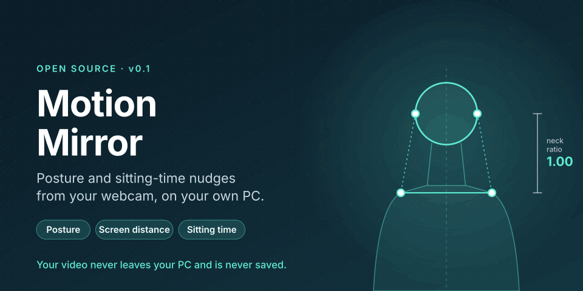

<p align="center">
  
</p>

# Emotion Mirror

[Español](README.es.md)

Local-first wellbeing copilot for people who work at a computer. It uses your webcam and on-device AI ([NeuroBrix](https://neurobrix.org)) to notice poor posture, long sitting spells, fatigue and tension, and gives you gentle, personalised nudges.

**Your video never leaves your PC and is never saved.**

> **Status: v0.1 (early).** Posture, screen distance, sitting time and calibration work and were checked by hand on Windows 11 with Python 3.11. Not yet confirmed on real hardware: desktop notifications, macOS and Linux. NeuroBrix is not wired in yet (planned for v0.3): v0.1 phrases the nudges with message templates from the rules file. Expect to tune thresholds to your own body and desk.

## What v0.1 does

- **Posture:** detects when your head sinks forward toward your shoulders.
- **Shoulder tilt:** detects when one shoulder is much higher than the other.
- **Screen distance:** detects when you lean in toward the screen.
- **Sitting time:** reminds you to stand up after long uninterrupted sitting.
- **Calibration:** all of the above are measured against *your* "sitting well" reference, recorded in 10 seconds.
- **Your rules:** thresholds, durations, cooldowns and messages live in a YAML file you can edit.

## Install, step by step

You need Python and a webcam. Everything below is typed in a terminal. The steps for Windows come first; macOS and Linux differ only where noted.

### 1. Install Python

Emotion Mirror needs **Python 3.10 or newer**. Python 3.11 or 3.12 is recommended (3.11 is what it was tested with).

First check whether you already have it. Open a terminal:

- **Windows:** press the Windows key, type `cmd`, press Enter.
- **macOS:** open the *Terminal* app.
- **Linux:** open your terminal.

Then run:

```
python --version
```

(on macOS and Linux: `python3 --version`). If it prints `Python 3.10` or higher, skip to step 2.

If it prints an older version, an error, or opens the Microsoft Store, install Python:

**Windows**

1. Go to <https://www.python.org/downloads/> and download the Python 3.12 installer for Windows.
2. Run it. On the first screen, **tick "Add python.exe to PATH"** (bottom of the window), then click **Install Now**.
3. Close the terminal and open a new one, then run `python --version` again. It should print the new version.

The Python from the Microsoft Store also works, but see the camera note in step 6.

**macOS**

Download the macOS installer from <https://www.python.org/downloads/> and run it, or, if you use Homebrew: `brew install python@3.12`. Verify with `python3 --version`.

**Linux (Debian / Ubuntu)**

```
sudo apt update
sudo apt install python3 python3-venv python3-pip
```

### 2. Download the project

**Without Git (simplest):** download <https://github.com/vladt2024/emotion-mirror/archive/refs/heads/main.zip> and extract it. On Windows, right-click the ZIP → *Extract All*. You get a folder called `emotion-mirror-main`.

**With Git:**

```
git clone https://github.com/vladt2024/emotion-mirror.git
```

### 3. Open a terminal inside the project folder

The folder must contain a file called `pyproject.toml`.

**Windows (cmd), if you extracted into your Downloads folder:**

```
cd %USERPROFILE%\Downloads\emotion-mirror-main
dir pyproject.toml
```

If `dir` says the file is not found, the extraction created a folder inside a folder. Go one level down and check again:

```
cd emotion-mirror-main
dir pyproject.toml
```

**macOS / Linux:**

```
cd ~/Downloads/emotion-mirror-main
ls pyproject.toml
```

### 4. Create a virtual environment and install

A virtual environment keeps the project's libraries separate from the rest of your system. You do this once.

**Windows (cmd):**

```
python -m venv .venv
.venv\Scripts\activate
pip install -e .
```

**macOS / Linux:**

```
python3 -m venv .venv
source .venv/bin/activate
pip install -e .
```

After activating, your prompt starts with `(.venv)`. The install downloads MediaPipe, OpenCV and a few other libraries and takes a few minutes. Check that it worked:

```
emotion-mirror --version
```

Use Command Prompt (`cmd`) on Windows. In PowerShell, activation can be blocked by the execution policy.

### 5. Download the models

```
emotion-mirror download-models
```

This fetches two small MediaPipe model files (face and pose) into `~/.emotion-mirror/models` (on Windows, `C:\Users\<you>\.emotion-mirror\models`). You do it once. It is the only time the program itself uses the network.

### 6. Allow camera access

**Windows 10/11:** open *Settings → Privacy & security → Camera* and make sure that:

- **Camera access** is on.
- **Let apps access your camera** is on.
- **Let desktop apps access your camera** is on.
- If you installed Python from the **Microsoft Store**, it appears in the app list as **Python 3.x**. Turn that switch **on** too, because the Store version has its own permission.

Close any app that is using the camera (Teams, Zoom, WhatsApp, Telegram, a browser tab).

**macOS:** the first time, allow camera access for your terminal or editor in *System Settings → Privacy & Security → Camera*.

### 7. Calibrate

Sit the way you *want* to sit: back supported, screen at eye level, shoulders relaxed. Your face, ears and both shoulders must be visible to the camera.

```
emotion-mirror calibrate
```

A 3-second countdown, then 10 seconds of capture. Stay natural. It ends with `Calibration saved`. If it says calibration failed, adjust the camera or your position so your face and both shoulders are visible, and run it again.

### 8. Run it

First a safe test that prints everything to the terminal and shows no popups:

```
emotion-mirror run --verbose --dry-run
```

Every 5 seconds you get a line like:

```
present=True {'neck_ratio_rel': 1.0, 'tilt_dev': 1.2, 'face_width_rel': 1.0, 'sitting_minutes': 0.1}
```

Try each posture for about 15 seconds and watch the numbers move:

| What you do | Metric | What you should see |
|---|---|---|
| Sit well | all | `neck_ratio_rel` ≈ 1.0, `tilt_dev` below 5, `face_width_rel` ≈ 1.0 |
| Slouch, head forward | `neck_ratio_rel` | drops toward 0.7 |
| Raise one shoulder | `tilt_dev` | rises above 8 |
| Lean toward the screen | `face_width_rel` | rises above 1.25 |
| Leave the frame | `present` | becomes `False` |

Stop with `Ctrl+C`. When the numbers look right, run it for real:

```
emotion-mirror run
```

Add `--verbose` to also print each nudge in the terminal, which helps if you do not see popups.

## Using it day to day

Every time you open a new terminal, go to the project folder and activate the environment first. You do **not** need to reinstall or recalibrate.

**Windows (cmd):**

```
cd %USERPROFILE%\Downloads\emotion-mirror-main
.venv\Scripts\activate
emotion-mirror run
```

**macOS / Linux:**

```
cd ~/Downloads/emotion-mirror-main
source .venv/bin/activate
emotion-mirror run
```

If you sit differently (new chair, new desk, new camera position), run `emotion-mirror calibrate` again.

## Commands

| Command | What it does |
|---|---|
| `emotion-mirror download-models` | Downloads the face and pose models (once). `--force` downloads again. |
| `emotion-mirror calibrate` | Records your "sitting well" reference. Options: `--seconds`, `--camera`, `--fps`. |
| `emotion-mirror run` | Watches posture and sitting time and shows nudges. |
| `emotion-mirror default-rules` | Prints the default rules file so you can copy and edit it. |

Options for `run`:

- `--verbose` prints the metrics every 5 seconds and also prints each nudge.
- `--dry-run` prints nudges instead of showing desktop notifications.
- `--rules my_rules.yaml` uses your own rules file.
- `--camera N` uses another camera (0 is the default, try 1 for an external webcam).
- `--fps N` changes the capture rate (default 6).

## Tuning the rules

Make your own copy of the rules and edit it with any text editor:

```
emotion-mirror default-rules > my_rules.yaml
notepad my_rules.yaml
emotion-mirror run --rules my_rules.yaml --verbose
```

(`notepad` is Windows; use `nano` or your editor elsewhere.)

Each rule watches one metric:

| Metric | Meaning | Default rule |
|---|---|---|
| `neck_ratio_rel` | Head height over your shoulders, relative to your calibration. About 1.0 when you sit as in calibration, lower when you slouch. | below 0.85 for 120 s |
| `tilt_dev` | How many degrees your shoulder line is off from your calibration. | above 8 for 120 s |
| `face_width_rel` | Face size relative to your calibration. Rises when you lean toward the screen. | above 1.25 for 90 s |
| `sitting_minutes` | Minutes of continuous sitting. Resets after about 5 minutes away. | above 50 |

Each rule also has `for_seconds` (how long the condition must hold), `cooldown_minutes` (minimum time before it can fire again) and a list of `messages` (one is picked at random). `settings.max_per_hour` caps the total number of nudges per hour.

To test quickly without waiting, use short values in your copy, for example `above: 0.5` for `sedentary` and `for_seconds: 10` for `slouch`. If a normal posture of yours sits close to a threshold and you get false alarms, move the threshold further away.

## Troubleshooting

**`'python' is not recognized` or the Microsoft Store opens.** Python is not installed or not on the PATH. Install it as in step 1 and tick "Add python.exe to PATH". Close and reopen the terminal.

**`'emotion-mirror' is not recognized`.** The virtual environment is not active. Run `.venv\Scripts\activate` (Windows) or `source .venv/bin/activate` (macOS/Linux) from the project folder. The prompt must start with `(.venv)`.

**`pip install` fails on `mediapipe`.** Use Python 3.11 or 3.12 instead of a very new or very old version, then delete the `.venv` folder and repeat step 4.

**`Could not open camera 0`.** Almost always permissions or a busy camera. Follow step 6, including the **Python 3.x** switch if you use the Store version of Python, and close other apps that use the camera. For an external webcam try `--camera 1`.

**`Missing model file` or `No calibration found`.** Run `emotion-mirror download-models` and `emotion-mirror calibrate`.

**`Calibration failed: only N usable frames`.** Your face, ears or shoulders were not visible enough. Sit farther from the screen, light your face, make sure both shoulders are in view, and retry.

**No popups appear.** Windows may be hiding them: check that Do Not Disturb / Focus is off in *Settings → System → Notifications*. Run with `--verbose` to see every nudge in the terminal too.

**Nudges never fire.** Run with `--verbose` and compare your metrics with the rule thresholds. A rule only fires if its condition stays true for its whole `for_seconds`.

**Remove everything.** Delete the project folder and the `~/.emotion-mirror` folder (on Windows, `C:\Users\<you>\.emotion-mirror`).

## How it works

One pipeline, running entirely on your machine:

```
camera -> signal extractor -> aggregator -> YAML rule engine -> notification
          (pose, face)         (smoothing,                       (NeuroBrix will phrase
                                relative metrics)                 the message from v0.3)
```

1. **Camera** (OpenCV) captures a few frames per second in memory.
2. **Signal extractor** (MediaPipe) turns each frame into a few numbers (neck-shoulder ratio, shoulder tilt, face width) and discards the frame immediately.
3. **Aggregator** smooths those numbers, compares them with your calibration and tracks how long you have been sitting.
4. **Rule engine** reads human-editable YAML rules and decides when a nudge is worth showing, with a per-hour limit and a cooldown per rule.
5. **Notifier** shows it as a desktop notification.

The camera uses MediaPipe for vision. NeuroBrix is a text/voice inference engine and is planned for phrasing the messages (v0.3) and for voice (v0.4).

## Modules and roadmap

| Version | Scope |
|---------|-------|
| v0.1 | Posture, movement / sedentary alerts, per-user calibration |
| v0.2 | Focus and fatigue signals, adaptive Pomodoro |
| v0.3 | Messages generated with NeuroBrix, daily summary |
| v0.4 | Mood check-in (encouragement, breathing exercises, poem on demand), voice, community rules |

A camera-free mode (keyboard and mouse activity only) is planned as an alternative for people who prefer not to use a webcam.

## Privacy principles

- **Everything is local.** No cloud inference and no telemetry. The only network use is the one-time model download (`download-models`) and installing the Python libraries.
- **No images or video are stored.** Frames are processed in memory and dropped immediately. Only your calibration numbers are kept, on your own machine, and you can delete them at any time.
- **Opt-in and personal.** You choose to turn it on, and you can turn it off at any time.

## Intended use

Emotion Mirror is a **personal tool for the person using the computer**. It is not designed, and must not be deployed, to monitor employees, students or any other third party.

Inferring emotions of people in workplaces and educational settings is prohibited under the EU AI Act. For that reason the project has no administrator mode, no multi-user reporting and no way to send data to anyone else, and contributions that add them will not be accepted.

## What it is not

- It does not "detect your emotions". It reacts to measurable cues such as posture and distance to the screen, and those cues can be wrong.
- It is **not a medical device** and does not diagnose, treat or prevent any condition. If you have persistent pain, fatigue or low mood, please talk to a health professional.

## Development

```
pip install -e ".[dev]"
pytest
```

The tests need no camera and no models.

## Contributing

Issues and ideas are welcome. Please keep the privacy principles and intended use above in mind: changes that weaken them will not be merged.

## License

[Apache-2.0](LICENSE)
